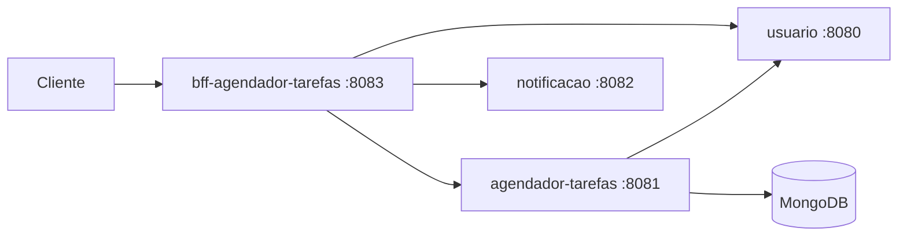

# agendador-tarefas

Microsserviço de tarefas do **Agendador de Tarefas**: cadastro, edição, exclusão e busca de tarefas por período, com controle do status de notificação. A autenticação usa o mesmo JWT emitido pelo serviço [usuario](https://github.com/GabrielBarrilli/usuario), consultado via OpenFeign.

**Stack:** Java 17 · Spring Boot 3.5 · Spring Security + JWT · Spring Data MongoDB · OpenFeign · MapStruct · Docker

## Arquitetura



Repositórios do ecossistema: [bff-agendador-tarefas](https://github.com/GabrielBarrilli/bff-agendador-tarefas) · [usuario](https://github.com/GabrielBarrilli/usuario) · [notificacao](https://github.com/GabrielBarrilli/notificacao)

## Endpoints

Base: `/v1/tarefas`

| Método | Rota | Descrição |
| --- | --- | --- |
| POST | `/` | Cria tarefa para o usuário autenticado |
| GET | `/email` | Lista as tarefas do usuário autenticado |
| GET | `/eventos?dataInicial=&dataFinal=` | Lista tarefas agendadas no período (ISO date-time) |
| PUT | `/?id=` | Atualiza tarefa |
| PATCH | `/?status=&id=` | Altera o status de notificação da tarefa |
| DELETE | `/?id=` | Remove tarefa |

## Como rodar

Pré-requisitos: Java 17 e MongoDB (local ou container), com o serviço `usuario` rodando na porta 8080.

```bash
export MONGODB_URI=mongodb://localhost:27017/agendador-tarefas
export JWT_SECRET=<mesma chave usada no serviço usuario>
./gradlew bootRun   # sobe na porta 8081
```

Também é possível gerar a imagem com o `Dockerfile` do projeto.
